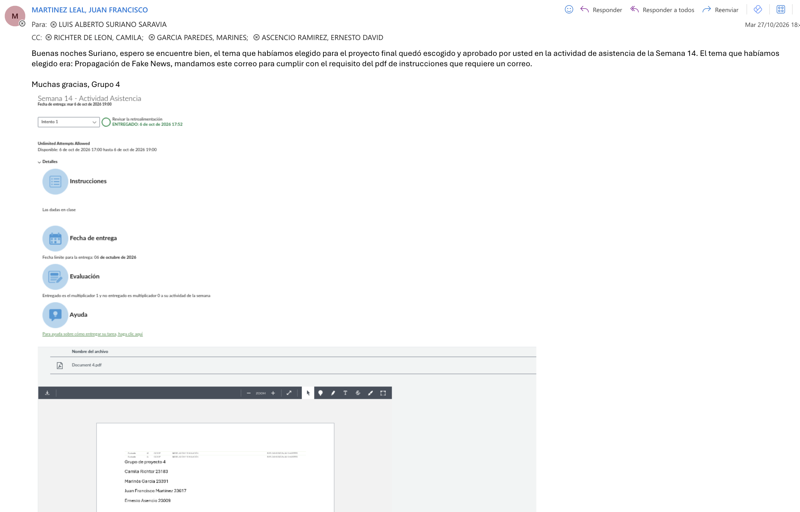

# Entrega parcial · Proyecto final de Modelación y Simulación
**Grupo 4 · Propagación de Fake News** · UVG
Integrantes: Camila Richter (23183), Marinés García (23391), Juan Francisco Martínez (23617), Ernesto Asencio (23009)

## 1. Tema
Cómo se propaga una noticia falsa en una red social y cómo se puede frenar con los recursos limitados de una plataforma.

## 2. Problema real y aplicación
Hay evidencia de que las noticias falsas llegan más lejos y más rápido que las verdaderas (Vosoughi, Roy & Aral, 2018) y de que afectan salud pública, procesos electorales y la respuesta ante crisis. Quien modera una plataforma necesita decidir cuándo intervenir y sobre quién, sin poder actuar sobre todos. Aplica a moderación de contenido, comunicación de salud pública, ciencia de redes y epidemiología computacional.

## 3. Objetivo y pregunta de investigación
**Objetivo general:** modelar y simular la propagación de una noticia falsa para comparar estrategias de intervención.
**Pregunta:** ¿cómo influyen la topología de la red, el origen de la noticia y el tipo y momento de la intervención en el alcance y la velocidad de la noticia, y qué estrategia reduce más el alcance por nodo intervenido?

## 4. Técnicas de Modelación y Simulación y por qué
1. **Modelo compartimental SEIR-D (ecuaciones diferenciales):** la difusión se parece a un contagio (contacto, decisión, pérdida de interés). Da una vista determinista, el R0 y el umbral de propagación de forma analítica.
2. **Simulación basada en agentes sobre redes complejas** (Erdős–Rényi, Barabási–Albert, Watts–Strogatz): el ODE supone que todos se mezclan por igual, pero las redes reales tienen pocos hubs y muchos nodos de grado bajo, y en redes con hubs el umbral puede desaparecer (Pastor-Satorras & Vespignani, 2001). Además, intervenir hubs solo se puede evaluar con topología.
3. **Monte Carlo (30 réplicas):** el ABM es estocástico; las réplicas dan intervalos de confianza al 95 %.
4. **Validación ODE vs ABM:** límite de campo medio, tamaño final analítico y contrastes cualitativos con la literatura.
Limitación declarada: los parámetros son ilustrativos, no calibrados con datos reales; se compensa con análisis de sensibilidad.

## 5. Entregables
Documento (lun 2 nov), repositorio público con el código, video, slides (máx. 10) y presentación en clase.

## 6. Cronograma
| Fecha | Hito |
|---|---|
| mar 27 – mié 28 oct | Esqueleto del repo, ODE, ABM base |
| jue 29 oct | Integración y entrega parcial en Canvas (límite vie 30) |
| sáb 31 oct | Experimentos finales y borradores del documento |
| dom 1 nov | Documento, slides y video terminados; congelamiento 22:00 |
| lun 2 nov | Entrega final |

## 7. Evidencia aprovación

